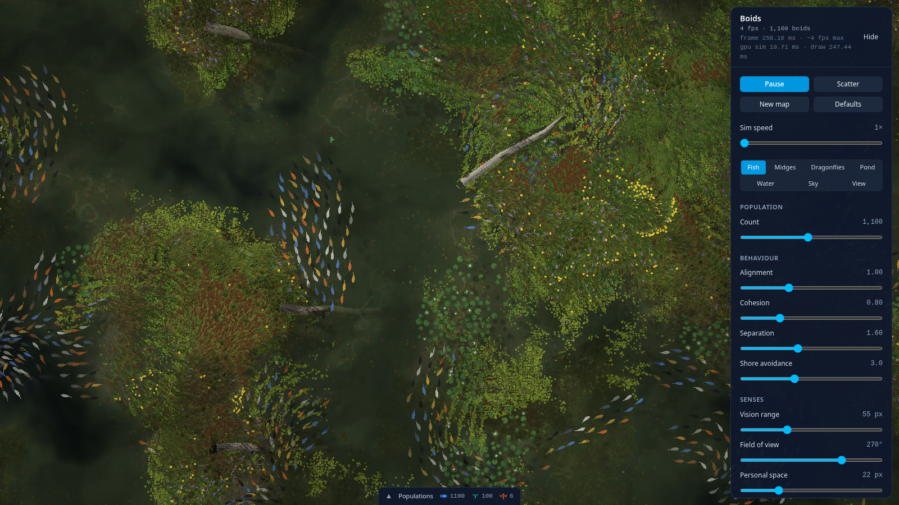

# Boid Evolution

A pond ecosystem simulated in the browser, built to keep changing over time instead of settling into one steady state. Fish and midges live in a pond that is drawn from scratch for every new map. Every creature runs on the GPU through one shared base boid, so new species and behaviours plug into the same machinery.



**The main goal is fish:** emergent schooling and foraging behaviour, and bodies that evolve under the pressures of the pond. The insects and the world around them are there to give the fish an environment worth adapting to.

## Why

Most boid demos fix their rules and tune them by hand. Here, as little as possible is scripted:

- **Behaviour emerges.** Schools, swarms, colonies and territories aren't programmed as groups. They come out of each individual's own rules and genes, and survive only if they help it feed and breed.
- **Traits evolve.** Each creature carries its own genome. Offspring inherit their mother's genome with mutations (now and then a mutation flips a gene's sign, so every gene also has a meaning when negative), and selection keeps whatever works in the current pond.
- **The world keeps changing.** Flowers drain and refill on their own cycles, clouds and plant shade move, predators rise and crash after their prey, and every new map has a different layout. No strategy stays best forever.

## What's in the pond

### Fish (the focus)

- Thousands of boids simulated entirely on the GPU (WebGL2 fragment-shader GPGPU): spatial hashing, sorting and neighbour search with a vision cone.
- Steering by alignment, cohesion and separation, plus avoiding the shore, banks and islands.
- Animated swimming (tail beat and body undulation), and murk that fades deeper fish, set as one curve of murk by depth.
- Every creature has a real height (z, with its vertical speed) as well as its place on the map: 0 is the water surface, below is negative. Fish swim at their own depth, wandering slowly up and down and rising over or diving under trunks at a limited rate, and a trunk is solid until they have actually cleared it. Midges fly at a height above the water. Click one to see its position and velocity in x, y and z.
- Per-fish traits already live in a GPU texture with room for a genome.

**Where it's heading:** fish get genomes like the insects have, covering behaviour (how they school, forage, flee and rest) and body (size, shape, fins, colour). Body traits will cost and gain something real in the pond, such as speed against energy, or size against hiding among plants. The fish then feed on the midges and are hunted in turn, so both behaviour and bodies evolve against a living, shifting ecosystem.

### Midges

- Small flies, boids on the GPU (tens of thousands run comfortably). Everything a midge does is its wiring: its inputs link straight to its outputs, with no layer in between and no hidden drives.
- **Inputs** come in two ranks, labelled in the wiring diagrams. **Vector** inputs see within its vision gene, in 3D (flower heads, scum and pads lie at the water or the ground), and sum everything of their kind seen into a 3D vector pointing to the near-weighted middle of them, closer counting more, plus a strength (how many, how near):
  - other midges, with two elements: where they are, and their heading against its own;
  - lily pads, and scum;
  - coloured things: flower heads near its colour gene, each counted by how near its colour as drawn is (fully at it, not at all 0.35 off in RGB). The colour gene (red, green and blue genes) starts at iris yellow in a fresh flock and mutates from there, so a line can drift towards pickerelweed or cattails, or away from every flower. A flower fades towards withered as it is drunk dry, so it drops out of view as it empties; only touching one tells whether it is open;
  - a threat (dragonflies: where and heading), which is always nothing until they return;
  - its own velocity (self: pushing along it keeps it flying against the drag).
  - noise: direction, a sideways heading of its own that turns smoothly to a new random heading every 1 ÷ (its wander rate gene) seconds, so it can roam with nothing in view.
  - **Scalar** inputs are one number each: noise (a fresh random draw each step, −1..1, averaging 0), the brightness where it is (1 in full sun, 0 under cloud cores), its age (1 at its lifespan), its energy (1 full), a constant 1 (a link from it is a bias, moving an output's threshold), and a latch: memory, 0 or 1, switched on and off by its source input (a gene) crossing its on and off thresholds (genes), and holding in between. Energy on at 0.9, off at 0.5 makes it “full” until laying has spent it.
- **Outputs**: steering, a vector in x, y and z (a vector input pushes it its way times its link's weight; a scalar has no direction, so it pushes only up or down), and eat and lay, scalars (each link adds weight times a vector input's strength or a scalar's value; the sum passes through that output's neuron, then above 0 the output is on, the larger winning). Each of eat and lay has a neuron with a type gene and a rate gene: plain (the sum as it is), latch (on at 1, off at 0 or below, holding in between), smooth (a moving average) or change (the sum less its moving average: it answers changes and gets used to a steady input). Their memory starts at 0 at hatching.
- With eat or lay on, it comes down to the water or the ground, and stays there while that output is on. Things on the water or ground (lily pads, scum, flowers) pull it only sideways: its height is its own, a flight height gene it holds by a damped pull, with its steering pushing it up or down from there. At 0 px it can only fly while its steering plus that hold push up (a flight height above 0 lifts it whenever eat and lay are off); otherwise it rests there. Coming down to eat or lay, it glides in, its steering still acting sideways at half, its sink easing to 20 px/s. It sees less the lower it is: a tenth of its vision gene at 0 px, rising linearly to all of it at 10 px and up. Eating, it drinks if it is on an open flower and eats nothing anywhere else. Laying, it lays a clutch if it has more energy than the clutch takes: the clutch's energy (shared by the hatchlings) plus a set cost per egg (Cost per egg), so many tiny eggs are not free. Two genes shape the clutch: how much energy goes in, and how many eggs it holds (the fraction by chance: 2.4 is two eggs, three 40% of the time), split evenly, so many small hatchlings or a few well-fed ones is itself something that evolves. Only eggs laid on scum hatch, after a set time, each into a midge with its own mutated copy of the genome; a clutch laid anywhere else is wasted.
- Flying, steering and its height hold drive it: air drag slows it, its max speed gene caps it, the map's edge and a ceiling stop it, and the wind carries it, harder the higher it flies. A raindrop falling through a flying midge kills it, and these are the same drops drawn on the water. Flying midges are drawn with a slight wing flutter, a dance of about a pixel; it is drawing only, and the sim never sees it.
- Past the lifespan (a slider), every second it gets slower and burns more energy, both by one ageing rate you set, until it starves of old age. Otherwise it dies when its energy runs out. What selects is how many eggs that hatch a midge lays before then.
- **Its wiring evolves, and is inherited.** Every link (input to output) is a gene, a bit, with a weight gene per element of its input and an activation gene: the link's sum passes through its activation (linear, step, tanh, ReLU, Gaussian, sine, sigmoid or abs) on its way to the output (for steering, the push's size). A link may also have a logic gate (gate, gate input and threshold genes): after its activation its result is multiplied by g from another input's value m (clamped to 0..1): AND (m), AND NOT (1 − m), IF (1 above the threshold), UNLESS (1 at or below it) or FLIP (−1 above it: a pull becomes a push). So one input can scale, switch or reverse another: scum IF latch pulls to scum only while full. A mutation may switch a link's activation or gate (back to none included), move its gate input, or shift its threshold. Fresh weights start small (±0.5) and can grow to ±3. A hatchling carries its parent's, mutated:
  - A fresh random flock starts with random links. Every hatchling may be rewired (Rewire chance, per link it could have), each rewiring a coin toss between making a link and breaking one, so the wiring has no drift towards more links or fewer.
  - How many genes mutate in a hatchling is a random (Poisson) count: its mean is the background mutations setting plus the parent's own mutations gene. Each mutation mostly scales the gene (×(1+σ·0.75)^Z) and partly adds to it (σ·0.25·range·Z), σ being the background size plus the parent's own mutation size gene, so how fast a line evolves evolves too. Rates are only scaled, and a mutation may instead flip a gene's sign.
  - Metabolism has three parts (defaults, all in the Midges tab): a base burn of 0.008 e/s, flight on top (0.008 e/s at 70 px/s, with the square of its speed; nothing while down), and its wiring, all the time, whether a link acts or not: 0.001 e/s the first link, each further one 2% dearer than the one before (compounding), so useless links are a cost that selection weeds out. Gates and latches are free.
- Click a midge to see its own wiring, live: each line carries what that link adds to its output now, green for positive and red for negative; hover one for its weights. Below it, everything else acting on its flight (air drag, coming down, the speed cap, the map's edge, ground and ceiling, wind drift), lit while it acts. *Population wiring* draws how common each link is among the living. Under each wiring diagram, *Everything else acting on the brain* lists every setting, constant and rule the brain computes with, plus that midge's own neurons and mutation genes, so nothing acts unseen. The **brain guide** (the Brain button in the panel header, or in the Midges tab) is a wide window explaining every input and output (what it senses, its values, how it changes over time), every activation function, gate and neuron type, and has example brains you can spawn, including the eat–lay cycler, a template that uses the latch, gates and noise: direction together.
- **Training**: with Train on, whenever every midge and egg is gone, more are spawned (Midges per session, 100 by default), random or from the best trained profile. Each session ending saves one midge of the latest generation it bred as a profile, if that generation beats every trained profile so far, so progress is never lost.
- Laying an egg on the water, or falling there dead, sends out a small round ripple.

### Dragonflies

Removed for now: they will be remade on the shared base boid.

### The world

- Each map is laid out from scratch: banks, islands, logs, and reeds, cattails, iris and pickerelweed spread across land, shallows and deeper water.
- A growth curve in the Pond tab sets how much grows where, from inland through the shore and shallows to deep water. Drag its points, click to add one, double-click to remove one. Below full growth, the ground opens in ragged holes and clearings of bare mud, wetter and darker towards the water, with puddles in the hollows. When most of the water is shallow (low water, lots of land), the water plants thin out by themselves so some water stays open.
- Plants and trunks shade the floor through the water, and, where the water is murky, the murky water itself.
- Lily pads, drifting scum, silt, and a cached floor of leaf litter, pebbles and sunken twigs, lit by the sun and casting small shadows.
- Fallen trunks in a range of colours, some birch-like; they carry lichen (more near the water), algae at the waterline, and now and then shelf fungi on their drier stretches. Their colours are baked once per trunk layout.
- Lily colonies come in pink, white or yellow, with open blooms and buds.
- The Pond tab sets how much of the map is land (same map, floor raised or lowered), the water depth, and how far the scum spreads, including how far it creeps in among the plants.
- Sun and moving cloud shadows (which the creatures react to), wind (it wanders around the set direction and speed, changing gradually every so often), ripples, caustics and refraction.
- Rain (Weather): by default it starts and stops by itself, with showers and dry spells taking turns (how often it rains and how long showers last are sliders). The rain toggle shows whether it is raining, and flipping it takes the rain over by hand. The clouds thicken and darken over a few seconds, and while it rains its strength drifts around a set strength. Each drop is a real point that lands under a cloud. Its ring spreads over the water, from a midge's ripple up to three times its size, and stays whole even where it spreads into sunlight. The midges' sim uses the very same drops.
- Resizing the window keeps the world while it still fits (only the view is cropped), so a fullscreen browser showing its toolbar does not reset the pond. A bigger window lays it out again.
- **New map** lays out new shores and a new floor. **Randomize world** keeps the map's shape but rerolls its conditions: the plant mix, water depth, colour (peaty blue-green to muddy brown) and murk, trunks, floor details, sun, wind and clouds. Varying the world is how the creatures are kept from fitting one pond.

## Running it

```bash
npm install
npm run dev       # open the printed local URL
npm run build     # production build in dist/
```

A WebGL2-capable browser is required.

Nothing spawns by itself: the pond starts empty.
- **Fish:** use the Count slider in the Fish tab.
- **Midges:** use *Spawn random flock* in the Midges tab.

The panel's tabs come in two groups: **Creatures** (Fish, Midges) and **World** (Pond, Water, Weather, View). Next to *Play* / *Pause*, the sim speed slider fast-forwards the whole world. Click a fish or midge to inspect it in its own panel at the top left: what it is doing, its readings, its wiring live (a midge), an arrow per force acting on it, and its genes; a thin line joins it to the creature. It works paused too (Escape or Close deselects). Hover over the tab at the bottom of the screen to see every population on one graph.

## Training and profiles

Evolution runs in the app: raise the sim speed at the top of the panel to fast-forward. (Headless training is gone for now, since the simulation runs on the GPU.)

In the app, each species' tab can:
- save a profile of either the **population average** (tagged *avg*) or the **selected individual's exact genes** (tagged *one*);
- import and export profiles (each species has its own format);
- spawn a population from a profile, or give it to everyone alive;
- lock everyone to a profile, so behaviour stops changing.

## Project layout

```
src/
  gpu/boids/   the GPU base boid (BoidKernel), its shader generator (codegen) and item sources
  gpu/         the pond on the GPU (nectar, items, shelter: PondGpu) and GPU fields (scum, silt, sway)
  species/     species definitions: genes, senses, forces and behaviour (fish, midges)
  render/      WebGL2 renderer and shaders (water, plants, creatures, clouds, focus overlay)
  sim/         CPU-side world: map, plants, lily pads, logs, genetics, profiles
  engine/      Engine: owns the world, steps the species, feeds the renderer
  components/  React UI: control panel, species tabs, population drawer
  config/      Default parameters and the world randomizer
```

Built with Vite, React 18, Tailwind CSS v4 and raw WebGL2.

## Adding a species

A species is one definition file in `src/species/` that the GPU base boid (`src/gpu/boids/BoidKernel.js`) runs:

- `genes`: its genome (`{ key, label, min, max }`); in GLSL each one reads as `G_<KEY>`. A boid's genes sit side by side in one texture, so a longer genome costs no extra texture units.
- `auxTextures`: 1 or 2 four-float textures of per-boid state that the species' own code reads (`aux`, `aux1`) and writes (`o_aux`, `o_aux1`) each step.
- `senses`: what it recognises. `flock` is its own kind, through the shared neighbour grid. `items` are fixed things from `gpu/PondGpu.js` (flowers, scum, lily pads), each giving the shader a pull `P_<key>`, a count `N_<key>` and the nearest one, `NEAR_<key>`.
- `tickParam` and `remember`: its tick rate, the param holding how many steps pass between looks around (the panel's Tick rate slider). Above 1 the boids take turns: each step a share of them senses its flock and items and keeps what it sensed in a small per-boid texture, and the rest recall theirs instead of scanning. `remember` names the flock totals `pre` declares that are kept (`{ n: 'int', sc: 'vec2' }`); the item senses are kept as the species' code uses them. Midges look every 4 steps by default, fish every step.
- `glsl`: its own code. `pre` sets how far it sees, `visit` runs for each neighbour, and `act` turns the senses into forces and moves it.
- `forces`: the force vectors to show. The selected boid's arrows and legend come from these.
- `spawn`, `describe`, `alive`: how a new one starts, how the selected one is described in the panel, and whether it counts as alive.
- `signals` (optional): `[key, glsl]` scalars the selected boid's debug pass writes out alongside its forces (midges: each input's strength, each attribute's amount, the urge to rest and the target height), which the panel uses for the wiring diagram. `glsl.sense` (optional) is extra sensing that runs with the flock and items, on its sensing ticks.
- `lays` and `egg` (optional): births. The shader marks a lay in `aux1`, and `engine/Laying.js` reads it back and places an egg (`egg()`, with a mutated copy of the genome) in a free slot. Midges use this.

Range rings, selection, the force overlay, profiles and stats come from the base for free.
